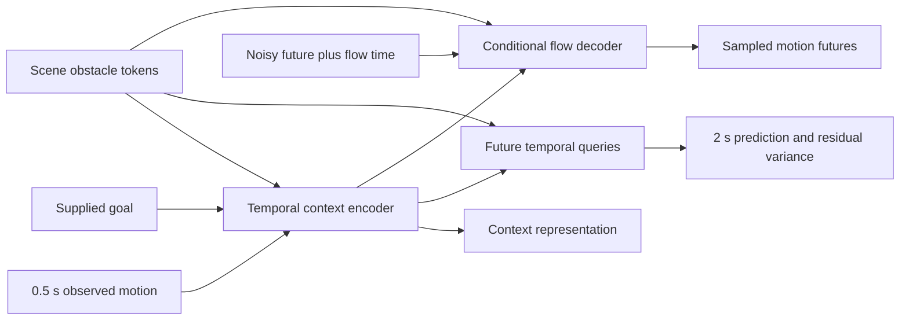

# Motion–Scene Pretrain

**A100 follow-up:** [Open the controlled experiment notebook](https://colab.research.google.com/github/linjiw/motion-scene-pretrain/blob/main/notebooks/MotionScene_A100_Experiments.ipynb). It reuses the Drive archive, builds a fixed scene-bearing validation split, and compares five fresh models at matched training exposure. [Pilot review and experiment protocol](docs/A100_EXPERIMENTS.md).

[](https://colab.research.google.com/github/linjiw/motion-scene-pretrain/blob/main/notebooks/MotionScene_Pretrain_Colab.ipynb)

**Google Colab:** open the notebook above, select a GPU runtime, and run the cells in order. Supply the dataset archive through Google Drive or the upload picker. The default is a short pilot; dropdowns select full training and masked/forecast/flow recipes. Completed stages can be saved to Drive, and the final cell downloads a report with the cost of every stage. [Colab instructions](docs/COLAB.md).

A portable **non-RL** research package for motion representations, scene attention, two-second future prediction, and conditional flow generation. Designed to start on one 16–24 GB GPU. The code needs NumPy and PyTorch; it does not need Isaac Sim, SONIC, MuJoCo, robot assets, or the original Flow checkout.

The first research question is whether scene-aware pretraining improves useful motion representations over a motion-and-goal baseline at a matched training budget. Attention and uncertainty are measurable outputs, not assumed explanations or safety certificates. Start with the simpler comparisons before increasing model size.



**Implemented**

- Contiguous masked-history reconstruction, scene-conditioned forecasting, and conditional flow matching; the flow convention is **data at t=0, noise at t=1**.
- A 1.89M-parameter small transformer, an optional larger configuration, and a no-scene baseline. The encoder consumes observed history, supplied geometry, and goal. Clean future targets never enter its representation.
- Unordered obstacle tokens, padding masks, an empty-scene token, and future-time attention diagnostics.
- A diagonal-Gaussian residual-variance head; separate calibration split, marginal coverage reporting, and two forecast-horizon bins. This is not collision-risk estimation or epistemic uncertainty.
- Train-only normalization, ancestry-separated splits, balanced group/scene sampling, checkpoints, receipts, embedding export, and a report bundle to send back.
- A verified real-data starter export with **20,000 windows, 868 generated motion clips, 65 ancestry groups**, 25 past and 100 future frames at 50 Hz.

**Data facts that change the research interpretation**

These are Kimodo-generated reference motions with compatible hindsight scenes, not measured human obstacle responses or controller action/outcome transitions. The goal is a retrospective reference pose one second ahead. The archive is dominated by empty scenes, so default research configurations balance ancestry groups and scene presence during sampling. Every archived scene retains an empty twin with the same motion. Such twins help test invariance; they do not teach a different avoidance response by themselves.

The source's official development/fresh/sealed data are excluded. The package's validation, calibration and test splits are carved only from original training lineages, with six ancestry groups in each holdout. No claims of broad generalization or physical improvement follow from a smoke run. Future work needs valid same-history *different-motion* alternatives, complete approach/adapt/exit sequences, and execution qualification. [Data details](docs/DATA.md) · [Research plan](docs/RESEARCH.md) · [Experiment matrix](docs/EXPERIMENTS.md).

## Start on the remote machine

Clone this public repository, copy the separately supplied dataset archive and its `.sha256` file, and install PyTorch for the machine's CUDA/driver combination using the [official installer](https://pytorch.org/get-started/locally/). Python 3.11 is the tested version; package requirement is Python 3.10+.

```bash
git clone https://github.com/linjiw/motion-scene-pretrain.git
cd motion-scene-pretrain
python3 -m venv .venv
source .venv/bin/activate
# Install the appropriate PyTorch build first, then:
python -m pip install -e '.[test]'

# Put the supplied archive and checksum beside each other before verifying:
sha256sum -c kimodo-passage-h25-f100-v1.tar.xz.sha256
mkdir -p data
tar -xJf kimodo-passage-h25-f100-v1.tar.xz -C data
python scripts/verify_data.py data/kimodo-passage-h25-f100-v1
OMP_NUM_THREADS=2 pytest -q

python -m motion_scene_pretrain.train \
  --config configs/smoke.json --data data/kimodo-passage-h25-f100-v1 \
  --output runs/smoke
```

The archive expands to approximately 638 MiB. Data, checkpoints, run outputs, and transfer archives are ignored by Git. The data manifest hashes every file. See [REMOTE_RUNBOOK.md](docs/REMOTE_RUNBOOK.md) for transfer, GPU trials, calibration, and reporting commands.

## Run the first controlled comparison

First inspect the training plan. `--dry-run` initializes the model and inspects the dataset but does not train or reserve GPU time. It does not estimate VRAM from unmeasured assumptions.

```bash
python -m motion_scene_pretrain.train \
  --config configs/forecast_small.json --data data/kimodo-passage-h25-f100-v1 \
  --output runs/forecast-plan --dry-run

# Scene-aware forecast, 15k steps.
python -m motion_scene_pretrain.train \
  --config configs/forecast_small.json --steps 15000 --seed 0 \
  --data data/kimodo-passage-h25-f100-v1 --output runs/forecast-s0

# Same training budget with scene paths disabled.
python -m motion_scene_pretrain.train \
  --config configs/forecast_blind.json --steps 15000 --seed 0 \
  --data data/kimodo-passage-h25-f100-v1 --output runs/blind-s0

# 5k masked steps + 10k forecast steps = 15k total optimizer steps.
python -m motion_scene_pretrain.train \
  --config configs/masked_small.json --seed 0 \
  --data data/kimodo-passage-h25-f100-v1 --output runs/masked-s0
python -m motion_scene_pretrain.train \
  --config configs/forecast_small.json --seed 0 \
  --init runs/masked-s0/checkpoint.pt \
  --data data/kimodo-passage-h25-f100-v1 --output runs/pretrained-forecast-s0
```

Equal optimizer steps and batch sizes do not equal FLOPs: masked pretraining uses fewer forward passes, and the no-scene model has fewer parameters. Report both presentations and wall time. `--init` starts a new optimizer and run; it is not exact resume. It requires matching model configuration and dataset manifest. Repeat informative comparisons with seeds 1 and 2 before interpreting them as more than a pilot. Keep the test split unused while making these decisions.

The generative extension uses `configs/flow_small.json`. Compare 15k flow steps from scratch against 5k masked +10k flow steps, or explicitly account for a longer forecast-to-flow pipeline. The small model is the default for 16–24 GB GPUs; measure peak allocation and throughput in a 200-step trial before a full run. If needed, reduce batch size and preserve total sample presentations when comparing arms. Larger capacity is a separate experiment.

## Return useful results

The runbook provides commands that produce `report.html`, `summary.json`, and `return-report.tar.gz`, including source/checkpoint/data hashes, loss history, calibration results, scene interventions and an attention example. Send that small archive back with a description of code changes. Keep checkpoints available separately for integration testing. A representation can be exported with:

```bash
python -m motion_scene_pretrain.embed \
  --checkpoint runs/masked-s0/checkpoint.pt \
  --data data/kimodo-passage-h25-f100-v1 --split val \
  --output runs/masked-s0-embeddings --device cuda
```

This package does not yet implement body-part attention, an ensemble, a physical collision critic, execution-based labels, or planner deployment. Those are specified as follow-on experiments, with data and evaluation requirements, in the research documents.
