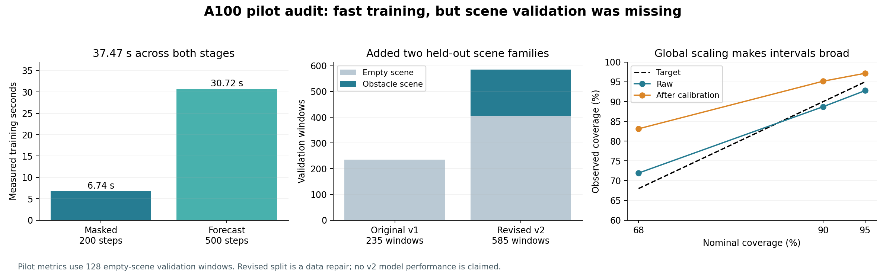

# A100 pilot review and the next experiments

[Open the A100 experiment notebook](https://colab.research.google.com/github/linjiw/motion-scene-pretrain/blob/main/notebooks/MotionScene_A100_Experiments.ipynb).

The first pilot completed successfully and is inexpensive to repeat. It does **not yet establish that masked pretraining, scene attention, or collision avoidance improved**. The most useful next step is a controlled comparison with corrected scene coverage, rather than simply increasing training time.

## What the pilot measured

Review scope: the supplied report for run `20261015T194008Z-37b623`, its masked/forecast receipts and logs, and a complete local audit of the frozen v1 dataset. A100 is the user-reported device; the original receipt records CUDA but not the GPU model. New receipts record the device name.

| Observation | Meaning |
|---|---|
| 200 masked steps in 6.74 s, then 500 forecast steps in 30.72 s | About 37.47 s across the measured training stages; excludes notebook setup, normalization, evaluation, and Drive transfers |
| 1.89M parameters; forecast peak allocated tensors 0.206 GiB | The model fits easily; this is not a GPU-utilization measurement or all-process VRAM |
| Forecast stage: 8,000 window presentations, about 260/s | Sampling is with replacement; this is not 8,000 distinct windows |
| Validation normalized MSE 0.784, equal-group MSE 0.748 | Only the first 128 of 235 validation windows were reported; no naive predictor or scratch control was measured |
| Validation joint-position RMSE 0.296 rad (about 17 degrees); planar-velocity RMSE 0.269 m/s | Offline error against generated references, not executed tracking or human naturalness |
| 95% marginal coverage: 92.78% raw → 97.17% calibrated | Global variance rescaling overshoots the nominal level; NLL improves 1.528 → 1.388, but calibration is not uniformly better |
| 68% coverage: 71.92% → 83.12% | Intervals become too broad at this nominal level; inspect horizons and groups rather than one aggregate |

The negative training objective near step 450 is mathematically valid: training uses Gaussian negative log likelihood without the additive constant, plus other nonnegative losses. It can be negative. The plotted values are individual sampled minibatches, so their oscillation is not a validation curve or evidence of overfitting by itself. Losses from masked and forecast stages also have different definitions.

## Three findings that change the experiment design

1. **The entire original validation split has no obstacles.** All 235 rows are empty-scene. Removing/shuffling an empty scene leaves the conditioning unchanged; the approximately `5e-16` response is not evidence of failed attention. Full evaluation alone cannot fix the missing population.
2. **The sampler underexposes obstacles.** In v1 only seven of 47 training ancestry groups contain scenes. The old `group_scene` policy first balances groups, then balances scene/empty inside an eligible group. Thus scene exposure is `7/(2×47) = 7.45%`, below the raw 16.86% scene-row fraction. After the new holdout, the same old sampler gives 5.56%. The new `scene_group` policy assigns 25% probability to scene examples, then balances groups within each presence category. This fraction is a starting hypothesis tested against the old sampler, not a proven optimum.
3. **Every one of the 3,448 scene rows shares exactly the same history, goal, and future as its empty-scene twin.** The scenes establish compatibility, not a different required response. The data can teach useful motion structure and resistance to unnecessary reactions; they cannot, by themselves, identify how the action should change when a different obstacle requires a different motion. Larger attention response is not automatically better.

The train-only normalizer is also dominated by a large ancestry group because it weights rows, while sampling balances groups. That is a weighting choice, not held-out leakage. Keep it identical across the first comparisons and inspect physical-unit errors; a differently weighted normalizer is a later isolated ablation.

## Fixed v2 protocol

The notebook derives a new dataset locally from the **same Drive archive**, requiring no new upload. Two scene-bearing groups move from v1 training to validation, selected before experiments by sorting `SHA256('20261015:' + group_id)`. All twins and overlapping windows stay together. All original validation, calibration, and test assignments are preserved; the original source corpus still contributes only its permitted training lineage.

| Split | Windows | Ancestry groups | Scene windows | Groups with scenes |
|---|---:|---:|---:|---:|
| Train | 18,495 | 45 | 2,998 | 5 |
| Validation | 585 | 8 | 180 | 2 |
| Calibration | 585 | 6 | 150 | 1 |
| Test, unused while choosing settings | 335 | 6 | 120 | 2 |

**Train fresh v2 models.** The pilot checkpoint and its normalizer have seen the newly held-out groups and must not be reused. Masked pretraining in the new suite uses only v2 training rows. The frozen derivation and manifest hashes are in `manifests/scene_holdout_protocol.json`; identical archive contents produce identical derivative hashes on other machines.

Do not compare the pilot's v1 validation score directly with v2 scores: the evaluation population has changed. This remains an exploratory scene holdout with two independent scene-bearing groups, not 180 independent experiments. Calibration's scene examples come from only one ancestry group.

## Run next: screen

Open the new notebook, keep **SUITE=screen**, **BATCH_SIZE=64**, and the Drive path `MyDrive/motion2scene/kimodo-passage-h25-f100-v1.tar.xz`. Run the cells in order. The notebook creates its own checkout and fresh output folder, derives/verifies v2, runs the following arms, and saves completed checkpoints to Drive.

| Arm | Steps | Scene sampling | Question |
|---|---:|---|---|
| blind | 2,000 forecast | 25%, scene input disabled | Can history and goal explain the future already? |
| scene | 2,000 forecast | 25% | Does adding scene input improve held-out prediction? |
| masked_scene | 500 masked + 1,500 forecast | 25% | Does masked pretraining earn its cost? |
| original_sampler | 2,000 forecast | Old group-first policy | Does explicit scene exposure help? |
| medium | 2,000 forecast; width 256, four layers | 25% | Does greater capacity help after correcting coverage? |

Each arm receives exactly **128,000 window presentations**, including the pretraining stage. Total screen: 10,000 optimizer steps across five arms, seed 0. All forecast stages use the same objective without auxiliary masked reconstruction; this isolates staged pretraining more clearly than the pilot's mixed downstream objective. Medium changes capacity; equal presentations are not equal FLOPs. Actual time and allocated/reserved memory are recorded rather than promised from extrapolation.

The primary checkpoint is the final fixed-budget checkpoint. Full validation runs every 500 training steps and at stage completion. The final evaluator uses every validation and calibration row and includes last-observed-state and train-mean baselines, equal-group error, scene-only error, native units, horizon errors, scene intervention denominators, and raw/calibrated uncertainty. Calibration fits interval scale only; do not select models using its errors. Test remains unused.

The screen's matched total budget asks whether pretraining helps per unit training exposure. It does not isolate a pure initialization effect at identical downstream exposure; a later matched-downstream control can answer that at additional total cost. Staged training resets the optimizer and starts a new seeded sampler stream, as recorded in receipts.

## Decisions after the screen

- **Scene versus blind:** inspect paired ancestry-group errors and the two obstacle groups separately. If scene input does not help, the compatible-twin construction is a plausible explanation; do not treat a stronger attention response as success.
- **Masked versus scratch:** repeat a promising advantage across seeds before expanding pretraining. Include both stage costs. A one-seed difference may be optimizer/sampling variation.
- **New versus old sampler:** check scene error and ordinary-motion error together. Oversampling five scene families may overfit them; a scene gain with worse clear-space behavior is a tradeoff.
- **Medium versus small:** keep the larger model only if held-out physical and group-balanced errors justify its measured cost. A lower training objective alone is insufficient.
- **Uncertainty:** look for useful coverage and width across horizons/groups. Higher coverage caused solely by widening every interval is not necessarily improvement. These are marginal residual intervals, not collision-risk probabilities.

`SUITE=confirm` runs the three core arms at 6,000 total steps each with seeds 0,1,2 (54,000 total steps). An explicit `ARMS` subset can reduce this after the screen. Report seed-level and paired group-level results; do not treat correlated scalar errors as independent trials.

`SUITE=generative` compares direct flow with masked→flow at 2,000 total steps each. Both use four samples per window and 16 integration steps. Report average-sample error, fixed-K oracle error, and diversity together. The forecast uncertainty head is separate from generated sample spread; neither is automatically epistemic uncertainty or safe control.

The return file is **`a100-return-report.tar.gz`**. It contains all stage metrics, configs, receipts, calibration/evaluation summaries, comparison CSV/HTML, and manifest binding. It excludes raw motion arrays and model weights. Completed checkpoints save separately in the suite's Drive folder. A stage interrupted before completion is not exactly resumable; create a fresh suite rather than treating a warm start as optimizer resume.

## What to scale in the data next

Prioritize independent motion/scene families over additional overlapping windows. Collect valid examples with shared observed history and goal where obstacle placement requires different futures, alongside irrelevant-obstacle controls. Preserve approach, adaptation, and recovery so normal arm swing and posture can return after the obstacle. Include speed changes, turns, tight passages, ducking, sidesteps, and clear-space examples with explicit geometry and timing.

Validate counterfactual compatibility before using a future as a positive target. Preserve motion ancestry and scene-layout ancestry in split metadata. Actions, contacts, collision outcomes, and tracking quality require actual execution data; do not infer them from a compatible reference pair. This pretraining package remains non-RL, while later planner/controller experiments can test whether the representation improves executed behavior.

Software validation on October 15, 2026: **101 CPU tests passed**, both notebooks passed Jupyter schema validation, and the A100 notebook's actual plan/train/compare/report cells completed a real-v2-data CPU smoke with three arms, 24 total optimizer steps, and 96 window presentations. Completed-stage reuse, report contents, and simulated Drive/browser handoff were verified. A separate full v2 validation pass covered all 585 windows including all 180 obstacle examples. These tiny runs validate software only; the prepared A100 comparison results are still pending execution in Colab.
