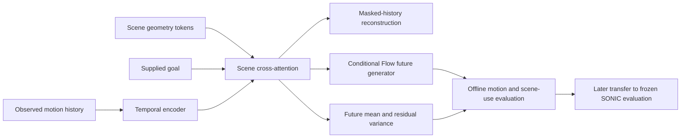

# Learning useful motion–scene representations without RL

Research design dated 2026-10-15. This package is an offline pretraining side project for Motion2Scene. Its outputs are representations, reference-motion generators, and prediction diagnostics. It does not train a controller, execute a robot, or establish collision avoidance.

The central question is whether a model can learn **when nearby geometry requires a change, which body motion is appropriate, and when normal movement should resume**, from the available paired data. A useful first result would be better held-out motion prediction and more selective scene dependence at matched training cost. A prettier attention map or lower training loss is insufficient.

## What the first package contains

The MVP uses 65-dimensional motion states, approximately 0.5 seconds of observed history, and a 2-second prediction horizon at 50 Hz. Scene input consists of masked 9-dimensional oriented-box/sphere tokens; goal input has four dimensions. The exact channel order, time indexing, and normalization are defined by the data schema and code, rather than inferred from these dimensions. The 65-dimensional reference state is **not** SONIC's 64-dimensional token action.

| Capability | Scope |
| --- | --- |
| Temporal motion encoder and scene cross-attention | Implemented MVP architecture; conditions only on available history, scene tokens, and supplied goal |
| Masked-history reconstruction | Implemented training objective; the masked content is from the observed history, not an oracle future |
| Future mean and diagonal Gaussian log-variance | Implemented prediction head; a useful baseline and residual-uncertainty diagnostic |
| Conditional flow-matching future generator | Implemented generative objective; context is fixed during each sampling integration |
| Scene-disabled baseline and scene perturbation diagnostics | Implemented comparison interface; check the run's config and report for the exact diagnostics used |
| Independent model ensemble, event-balanced curriculum, paired intervention supervision, body-part geometry heads | Research extensions; not implied by the MVP |
| FK collision labels, physical contact risk, action consequences, dynamic obstacles, sensor uncertainty | Not provided by this MVP |

“Implemented” describes available code, not a successful real-data experiment. CPU or synthetic smoke tests only establish that the pipeline runs. Report the actual dataset receipt, model commit, and completed run before making a learning claim.



## Why this is a plausible direction

The main Motion2Scene program already found that scene inputs can be ignored unless the data distinguishes different futures for the same history. Its later selectivity experiments also found that adding irrelevant obstacles can reduce some spurious map responses, while nearby side obstacles remain harder. These are reasons to test **information and data design**, rather than assume a larger attention network will solve the problem. Existing findings remain tied to their original data, training regime, and kinematic evaluation; this package has no inherited performance result.

Three explanations compete:

1. **Representation bottleneck:** the scene and motion are available, but the encoder fails to relate geometry to future movement. Cross-attention or explicit relational supervision should help at fixed data.
2. **Identification bottleneck:** each motion has one compatible scene, and motion history or the goal nearly determines the future. More attention layers cannot infer a missing causal contrast. Valid same-history scene/future alternatives should matter more.
3. **Execution bottleneck:** an offline prediction is good but its reference is not followed faithfully by SONIC. Better offline losses alone may not improve navigation. This requires a later executed evaluation, outside this package.

Keep these explanations distinct in the report. The first two can be studied remotely without RL or a simulator.

## Learn in three stages, and retain the simpler controls

The proposed sequence is masked-history pretraining → conditional future prediction → conditional flow matching. It is a research protocol, not a claim that sequential training is already superior to joint training. The trainer supports `masked`, `forecast`, and `flow` modes, and `--init` warm starts a new run with a new optimizer. Its current warm start requires matching architecture and the same dataset manifest; motion-only-to-paired-data or different-architecture transfer needs a documented extension. Use the README for the exact staged commands.

**Stage A: learn local motion structure.** Mask portions of the observed history and reconstruct only the missing values. Use whole-frame spans and, in a later ablation, coherent joint groups. Random single-coordinate masks alone may be solved through trivial local interpolation. Keep the latest measured state available in the first planning-oriented experiment; test removing it separately. The network may attend bidirectionally within the observed history: all those frames exist at decision time. It must not receive ground-truth future frames as encoder context.

This objective can learn temporal regularities and robustness to missing history. It does not ensure scene use: if the motion alone solves reconstruction, ignoring the scene is reasonable. Report scene-free reconstruction and downstream frozen-encoder probes alongside full fine-tuning.

**Stage B: learn the next 1–2 seconds and a diagnostic uncertainty head.** Predict the future mean and diagonal log-variance from the observed history, scene, and goal. Score separate horizons, not just the average over 100 frames. Predicting a single mean is a strong, inexpensive baseline but can average distinct valid futures. A high Gaussian variance may merely surround an implausible average; it is not a replacement for a multimodal generator.

**Stage C: learn a distribution of plausible future references.** Train conditional flow matching with future motion `y`, Gaussian noise `epsilon`, and flow time `t`:

```text
x_t = (1 - t) * y + t * epsilon
target_velocity = epsilon - y
L_flow = mean_valid ||v_theta(x_t, t, history, scene, goal) - target_velocity||^2
sampling: integrate from t=1 (noise) to t=0 (motion)
```

This convention intentionally matches the current PASSAGE-style Flow direction. Flow time is unrelated to physical time within the two-second motion chunk. Fixed context during integration does not mean encoder weights are frozen during training. Compare a generator trained from scratch, one initialized from Stage A, and a joint-objective model at a matched total optimization budget. Include pretraining cost in that budget.

The future Gaussian objective has the usual form `0.5 * (exp(-logvar) * residual^2 + logvar)` on valid, normalized channels; the reported NLL omits the constant Gaussian term. The current trainer adds a small mean-squared-error stabilizer, and its forecast/flow modes can retain auxiliary reconstruction. The masked reconstruction term is evaluated only on masked valid history. Keep objective weights and normalization statistics in the receipt; compare objectives in native physical units at evaluation. A lower combined loss may only reflect changing task weights. Do not present Flow loss as a navigation metric.

## Attention over the next 1–2 seconds

Cross-attention lets motion queries use different scene objects at different forecast times. The research hypothesis is that **the relevant object and body response change across approach, entry, passage, and recovery**. Proximity alone is not relevance: an obstacle beside the shoulder may matter during a turn, while a closer object behind the robot may not affect the current plan.

The MVP starts with ordinary learned cross-attention. Proposed extensions, in order of diagnostic value, are:

1. **Time-indexed relevance diagnostics.** Inspect attention over future-time queries alongside the resulting motion and obstacle removal effects. Keep scene IDs stable under display and permutation. Attention weight is a routing statistic, not automatically a causal explanation or uncertainty score.
2. **Valid contrast supervision.** Where the same history and goal have qualified futures in different scenes, train each condition on its own valid target. An obstacle replacement does not make the original future a correct label. Where an added obstacle is verified irrelevant to the full body trajectory, retain the same target and test consistency.
3. **Body-part/time relation prediction.** Add a head for future distances between specific body parts and scene geometry once a documented, tested FK/geometry labeling pipeline exists. Predict distances before trying to predict binary contact. The label's geometry model and discretization belong in the dataset receipt.
4. **Short/long temporal resolution.** Dense prediction near the first committed segment plus coarser future context may reduce compute. Test equal latency and comparable horizon coverage; do not shorten the anticipation horizon silently.

Do not initially force attention to peak on the nearest obstacle. Such supervision could bake in the same unnecessary defensive response we want to avoid. Nor should all generated futures be constrained to copy one observed arm trajectory when several natural alternatives are valid.

## Keep three meanings of uncertainty separate

| Quantity | Useful interpretation | What it does not establish |
| --- | --- | --- |
| Different futures sampled from one Flow model | The model's learned spread over possible references under a fixed condition | Epistemic uncertainty, calibrated coverage, or safe diversity |
| Diagonal variance from the future predictor | Input-dependent predictive residual scale under the assumed Gaussian model | Pure observation noise, a unique aleatoric decomposition, or collision probability |
| Disagreement across independently trained models | A practical signal of model sensitivity and possible lack of training support | Guaranteed out-of-distribution detection or a Bayesian posterior |

The Gaussian residual includes unobserved intent, alternative futures, limited model capacity, annotation error, and observation noise. Single outcomes for each unique input do not identify these components cleanly. “Aleatoric” and “epistemic” are useful conceptual distinctions; the MVP must report what it actually computes.

For an ensemble of scalar Gaussian predictions, total predictive variance can be summarized as `mean(model_variance) + variance(model_mean)`. This algebra does not prove the two empirical terms perfectly identify noise and knowledge uncertainty. With Flow samples, separate variation across samples within one model from variation across independently trained models, using matched conditions and a stated estimator. Identical seeds or heads sharing an otherwise fixed backbone are not independent model replicas.

Calibrate on a separate ancestry-disjoint subset drawn from the original training lineage. The portable corpus creates its own train/validation/calibration/test groups within that original training population; its test split is **not** the original project's sealed or external evaluation panel. Preserve the original held-out evaluation lineage. Fit any variance scale only on calibration examples, then report interval coverage and width on the locked package test set by forecast horizon. Nominal pointwise 90% coverage does not mean 90% of entire trajectories are covered. A conformal extension needs an explicitly stated exchangeability unit and assumptions; overlapping windows are not independent clips. Neither pointwise calibration nor conformal marginal coverage certifies collision-free execution.

Near obstacles or during a movement transition, prediction errors may rise, but uncertainty should not be forced to rise by label. Familiar narrow passages can be predictable; unfamiliar open scenes can be uncertain. Test whether uncertainty ranks actual error within these conditions and whether it adds information beyond distance, speed, and horizon baselines.

## Organize data around independent decisions and provenance

The package schema is the operational contract. These principles explain why its fields matter:

- Preserve raw sources unchanged and store processed, content-hashed arrays separately from manifests. Keep raw and derived motion out of Git. Transfer the private data archive only to the intended authorized machine; a private code repository is not a data redistribution license.
- Assign all windows, scene variants, mirrored copies, and synthetic edits from the same ancestral clip/group to one split. Carry both original split and new purpose, such as train, calibration, or validation. Do not silently promote original validation or sealed data into pretraining.
- Record scene origin: observed during motion, generated jointly with motion, fitted afterward, or unknown. A hindsight-compatible scene supports compatibility learning; it does not establish that the original person or controller perceived and reacted to that obstacle.
- Record physical units, frame rate, joint order, state channels, coordinate frame, grounding transform, scene transform, and temporal alignment. Apply the same spatial transform to motion, scene, and goals. Preserve missingness rather than encoding missing obstacles as real geometry.
- Record the source of the goal. A goal derived from the recorded future endpoint or future heading is privileged prediction conditioning unless the deployed planner will receive the same information. Report such runs as reference-conditioned; later route-goal transfer requires a separate experiment.
- Preserve complete approach/adapt/exit/recovery sequences. Sliding windows increase training examples, not independent experience. Report source hours, distinct ancestors, scenes, and event coverage before reporting window count.
- Label geometric proxies as proxies. Reference clearance is not executed contact force. A human motion-scene pair does not supply robot actions, rewards, or intervention outcomes.

For scaling, first increase distinct ancestry and decision coverage; then improve valid scene contrasts and recovery transitions; then increase model capacity. Motion-only clips can support Stage A but cannot be silently treated as scene-conditioned examples. If the dataset contains mostly comfortable compatible motion, model size will not create reliable supervision for hard traversal choices.

## Primary literature and the local design decision

Sources checked on 2026-10-15. This is a targeted design review, not a novelty survey or a reproduction claim. No source performance number is transferred to our robot.

| Source | Verified idea and proposed use | Boundary |
| --- | --- | --- |
| [MotionBERT, ICCV 2023](https://openaccess.thecvf.com/content/ICCV2023/html/Zhu_MotionBERT_A_Unified_Perspective_on_Learning_Human_Motion_Representations_ICCV_2023_paper.html) | Learns motion representations by reconstructing 3D motion from corrupted partial 2D inputs. Motivates testing reconstruction-based initialization. | Its input/task differ from robot-state scene-conditioned control. Our 65D masked-history objective is an adaptation, not MotionBERT reproduction. |
| [Scene-aware Human Motion Forecasting via Mutual Distance Prediction](https://arxiv.org/html/2310.00615v2) | Explicit body–scene distances and consistency connect global and local motion. Motivates a future relational geometry head. | Requires accurate geometry/body mappings. Its forecast representation does not supply physical robot contact labels. |
| [SceneDiffuser, CVPR 2023](https://openaccess.thecvf.com/content/CVPR2023/papers/Huang_Diffusion-Based_Generation_Optimization_and_Planning_in_3D_Scenes_CVPR_2023_paper.pdf) | Studies scene-conditioned generation with optimization/planning objectives. Supports conditioning the full future trajectory on the scene. | The MVP does not implement its optimization guidance or establish its physical assumptions. |
| [Flow Matching for Generative Modeling](https://arxiv.org/html/2210.02747v2) | Regresses conditional vector fields without simulating the generative ODE during each training target construction. Supplies the generative learning principle. | A good density model is not necessarily a good executed planner. The implementation's flow-time direction must be explicit. |
| [Kendall and Gal, NeurIPS 2017](https://arxiv.org/html/1703.04977v2) | Distinguishes observation-related and model-related uncertainty; motivates input-dependent residual scale. | A single future Gaussian head does not identify those causes separately. |
| [Deep Ensembles, NeurIPS 2017](https://arxiv.org/html/1612.01474v3) | Independently trained predictive models provide a practical uncertainty baseline. | Calibration and behavior under distribution shift must be measured here; disagreement can be confidently wrong. |
| [A Gentle Introduction to Conformal Prediction](https://arxiv.org/html/2107.07511v6) | Explains prediction-set calibration and its assumptions. Guides a possible later calibration study. | Marginal coverage is neither per-scene conditional coverage nor a closed-loop safety guarantee. |
| [Jain and Wallace](https://aclanthology.org/N19-1357/) and [Wiegreffe and Pinter](https://aclanthology.org/D19-1002/) | Their attention-interpretation debate motivates intervention and stability tests rather than treating heatmaps as self-validating. | Both study NLP settings; our transferable lesson is methodological, not an empirical robotics result. |

The decisive comparisons, reporting contract, and stop rules are in [EXPERIMENTS.md](EXPERIMENTS.md). The intended handoff is a reproducible offline result bundle; a later simulator evaluation decides whether a useful representation becomes a better Motion2Scene planner.
